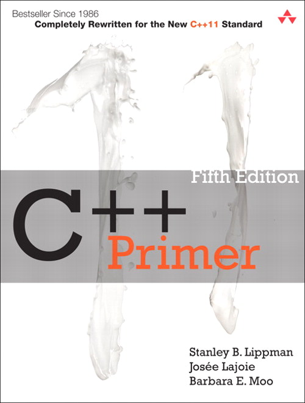

# C++_Primer_Practice
 

參考課本：C++Primer(黃銘偉 譯)
--------------------------

--------------------------
* [範例程式](sampleCode)：課本隨附的範例原始碼，依章節分在 `1`～`19`，附 GCC makefile 與編譯說明 PDF

* [我的練習紀錄檔](myPractice)：自己的習題解答（Visual Studio 專案），目前完成第 1 章的 1-20～1-23

## 執行練習

用 Visual Studio 2019 以上開啟 `myPractice/CH1/<題號>/<題號>.sln` 建置執行。範例程式可以在 `sampleCode` 用 GCC 與 `makefile` 編譯。